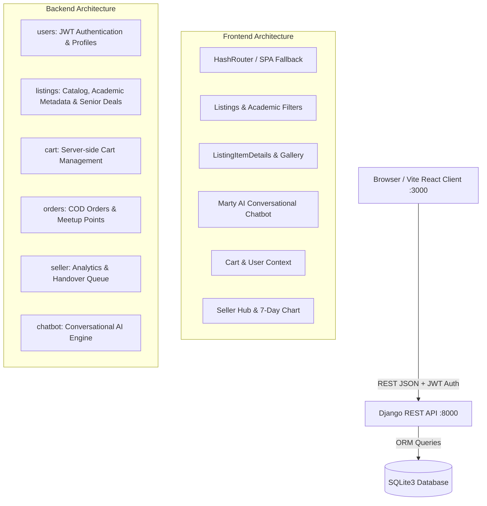

# 🎓 CampusMart — College Campus Peer-to-Peer Marketplace

[](https://github.com/campusmart-org/CampusMart)
[](http://localhost:3000)
[](http://localhost:8000)
[](LICENSE)
[](https://vercel.com)

> **CampusMart** is a comprehensive, student-centric marketplace platform engineered to facilitate peer-to-peer commerce within college campus ecosystems. Students can buy, sell, exchange textbooks, electronics, campus bicycles, and dorm essentials with zero shipping fees, verified on-campus safe meetup points, and risk-free Cash-on-Delivery payment.

---

## 🎯 Project Aim & Vision

### The Problem in College Campuses
Every semester, thousands of college students encounter recurring challenges:
1. **Exorbitant Textbook & Gear Costs**: New engineering textbooks, scientific calculators (e.g., Casio FX-991EX), lab coats, and engineering drafters cost thousands of rupees when purchased new from retail stores, only to be used for a single 4-month semester.
2. **Dorm Waste & Senior Departure Bottlenecks**: Graduating seniors often abandon or undersell valuable bicycles, study lamps, electric kettles, and mattresses because open marketplaces (OLX, Facebook Marketplace) involve strangers, high fraud risk, and off-campus logistical hassles.
3. **Delivery Overhead & Payment Scams**: Courier shipping on campus is slow, costly, and frequently plagued by delivery delays to hostel rooms. Online prepayment to unverified individuals frequently leads to scams.

### The CampusMart Solution
**CampusMart** solves these challenges through a dedicated campus hyper-local platform:
- **Zero Delivery Fees**: 100% on-campus physical handovers between enrolled students.
- **Safe Campus Meetup Points**: Fixed, public, well-lit handover locations: **Library Steps**, **Main Gate Campus Arch**, and **Student Canteen**.
- **Risk-Free Cash-on-Delivery (COD)**: Payment (Cash or UPI) happens exclusively upon physical inspection of the item.
- **Senior-Only Clearance Deals**: Authenticated graduating seniors can mark dorm items as clearance deals to pass them along to juniors at steep discounts.
- **Academic Syllabus Alignment**: Direct filtering by Branch (**CSE, ECE, MECH, EEE, CIVIL, Common**), Semester (**1 to 8**), and Course Code (**CS201, MA101, etc.**).
- **24/7 Marty AI Assistant**: A conversational ChatGPT-style AI assistant trained on the live database to help students search listings, recommend meetup points, and understand safe buying and selling procedures.

---

## ⚡ Demo Test Accounts

The local database comes pre-seeded with **54 verified campus listings** and **6 historical orders**. Use the credentials below to experience both roles:

| Role | Username | Password | Capabilities & Access |
| :--- | :--- | :--- | :--- |
| **Seller** | `Priya` | `secret123` | Owns all 54 listings, accesses Seller Hub, manages orders, advances shipment statuses, views 7-day sales chart |
| **Student / Buyer** | `Arjun` | `secret123` | Browses listings, unlocks Senior Deals, adds items to persistent cart, places COD orders, tracks delivery stages |
| **Visitor** | *(Not logged in)* | — | Public catalog browsing, search, branch/semester filters. Senior Deals and cart remain locked until sign-in |

---

## 🚀 Live Links & Local Endpoints

- **Frontend Application**: [http://localhost:3000](http://localhost:3000)
- **Backend API Server**: [http://localhost:8000](http://localhost:8000)
- **Catalog API Endpoint**: [http://localhost:8000/api/listings/](http://localhost:8000/api/listings/)
- **AI Chatbot Endpoint**: [http://localhost:8000/api/chatbot/](http://localhost:8000/api/chatbot/)
- **GitHub Repository**: [https://github.com/campusmart-org/CampusMart](https://github.com/campusmart-org/CampusMart)

---

## 🌟 Key Platform Features

### 1. 🤖 Intelligent Conversational AI Assistant ("Marty")
- Conversational ChatGPT-style agent responding naturally to casual greetings (*"hi"*, *"hello"*, *"how are you?"*).
- Dynamic database querying across title, category, branch, hostel, and subject codes.
- Returns **interactive mini-cards** directly inside the chat so students can click and view matching listings.
- Explains campus buying steps, selling guidelines, order lifecycle, and safety checklists.

### 2. 🔍 Rich Product Details Experience
- **Multi-Angle Gallery**: High-resolution image showcase with thumbnail switcher and automatic SVG/Unsplash fallbacks to prevent broken images.
- **Student Savings Calculator**: Automatic comparison against estimated store retail MRP showing exact savings (e.g. *Save ₹350 (44% OFF)*).
- **Interactive Information Tabs**:
  - **Item Specifications**: Physical condition score (Like New, Good, Fair), hostel room origin, included accessories, and curriculum alignment.
  - **Campus Meetup Points**: Visual cards for Library Steps, Main Gate, and Student Canteen with best handover time slots.
  - **Safety Checklist**: 4-step campus verification checklist (Inspect before paying COD, meet in daylight, verify student ID).
  - **Student FAQs**: Category-tailored answers for textbooks, electronics, and campus cycles.
- **Seller Trust Card**: Response time indicators, hostel wing, and verification badges.
- **Quick Action Bar**: Quantity selector, animated *Add to Cart*, *Instant COD Checkout*, and *Share Listing* to clipboard.

### 3. 🎓 Senior-Only Clearance Deals
- Exclusive discount tier posted by graduating seniors clearing their dorm rooms.
- Gated behind authentication: unauthenticated visitors are prompted to sign in with HTTP 401 response protection.

### 4. 📚 Academic Department & Semester Filtering
- Instant filtering for engineering streams: **CSE**, **ECE**, **MECH**, **EEE**, **CIVIL**, and **Common 1st Year**.
- Filter by semester (Semesters 1 through 8) to find exact syllabus books and lab equipment.

### 5. 🛒 Persistent Server-Side Cart & COD Checkout
- Real-time persistent cart stored in the Django backend database per user.
- Interactive checkout allowing selection of verified meetup points (**Library Steps**, **Main Gate**, **Student Canteen**).
- 4-stage order tracking: `Placed` ➔ `Shipped` ➔ `Delivered` ➔ `Cancelled`.

### 6. 💼 Seller Hub & Handover Management
- 4 Key Performance Indicators (KPIs): Total Sales (₹), Active Listings, Orders to Hand Over, and Average Rating.
- Interactive **7-day sales bar chart** displaying dynamic daily revenue.
- Handover queue with one-click status transitions to advance orders upon meeting buyers.

---

## 🏗️ System Architecture



---

## 📡 The 21 REST API Endpoints

### 🔐 1. Authentication & Users
- `POST /api/users/register/`: Register a new campus student account (`201 Created`).
- `POST /api/users/login/`: SimpleJWT login returning `access` and `refresh` tokens (`200 OK`).
- `POST /api/users/login/refresh/`: Refresh expired access token (`200 OK`).
- `POST /api/users/logout/`: Blacklists refresh token (`205 Reset Content`).
- `GET /api/users/profile/`: Fetch authenticated student profile and `user_type`.

### 📚 2. Listings Catalog
- `GET /api/listings/`: Paginated public catalog with branch, semester, hostel, category, and price filters.
- `GET /api/listings/?is_senior_deal=true`: Senior deals strip (returns `401` if not logged in).
- `POST /api/listings/`: Post a new listing (authenticated).
- `GET /api/listings/<id>/`: Retrieve one listing (answers `401` for senior deals if unauthenticated).
- `GET /api/listings/<id>/similar/`: Retrieve similar category campus listings.

### 🛒 3. Cart Management
- `GET /api/cart/`: Fetch current user's server-stored cart.
- `POST /api/cart/add/`: Add listing (`{"listing": id, "quantity": 1}`) — returns `201`.
- `PATCH /api/cart/items/<id>/`: Update item quantity (`{"quantity": n}`).
- `DELETE /api/cart/items/<id>/`: Remove single item row (`204 No Content`).
- `DELETE /api/cart/`: Clear whole cart (`204 No Content`).

### 📦 4. Orders & Checkout
- `POST /api/orders/checkout/`: Place order with `{ payment_method, meetup_point, address }` — returns `201`.
- `GET /api/orders/`: List logged-in student's orders.
- `GET /api/orders/<id>/`: Details of one order.
- `POST /api/orders/<id>/cancel/`: Cancel placed order.

### 💼 5. Seller Hub & Analytics
- `GET /api/seller/listings/`: List seller's own listings.
- `POST /api/seller/listings/`: Create new seller listing.
- `GET/PATCH/DELETE /api/seller/listings/<id>/`: Edit or delete seller listing.
- `GET /api/seller/orders/`: Orders queue to hand over.
- `PATCH /api/seller/orders/<id>/status/`: Advance row status (`placed` ➔ `shipped` ➔ `delivered`).
- `GET /api/seller/dashboard/`: 4 KPI metrics, "Still to Hand Over" queue, 7-day sales chart, and top items.

### 🤖 6. AI Campus Assistant
- `POST /api/chatbot/`: Natural language conversation, dynamic product discovery, and campus guidance (`{"message": "..."}`).

---

## 🛠️ How to Run the Project Locally

### Prerequisites
- Python 3.10+
- Node.js 18+ & npm

### Terminal 1: Backend (Django REST Framework)
```powershell
# Navigate to backend directory
cd backend

# Apply database migrations
.\env\Scripts\python.exe manage.py migrate

# Seed accounts, 54 listings, and demo orders
.\env\Scripts\python.exe manage.py seed_listings --with-orders

# Start Django backend server on Port 8000
.\env\Scripts\python.exe manage.py runserver 8000
```

### Terminal 2: Frontend (Vite + React)
```powershell
# Navigate to frontend directory
cd frontend

# Install dependencies
npm install

# Start Vite dev server on Port 3000
npm run dev
```

Visit **[http://localhost:3000](http://localhost:3000)** in your browser.

---

## 🌐 Deployment Configuration

### Deploying Frontend to Vercel
CampusMart is pre-configured with a root `vercel.json` file. You can deploy directly by importing the repository into Vercel:
```json
{
  "buildCommand": "cd frontend && npm install && npm run build",
  "outputDirectory": "frontend/dist",
  "framework": "vite",
  "rewrites": [
    {
      "source": "/(.*)",
      "destination": "/index.html"
    }
  ]
}
```

### Deploying to GitHub Pages
The frontend uses `HashRouter` and includes `public/404.html` SPA fallback routing, preventing 404 errors on page reloads or deep links:
1. Run `npm run build` in `frontend/`.
2. Deploy the `frontend/dist` directory to the `gh-pages` branch.

### Full-Stack Render Deployment
A root `render.yaml` specification is included to deploy both the Python Django backend and the static frontend simultaneously.

---

## 👥 Community & Support

- **Project**: CampusMart College Marketplace
- **Community**: CampusMart Open-Source Community
- **Inquiries & Support**: `support@campusmart.edu` / `contact@campusmart.dev`
- **License**: Released under the [MIT License](LICENSE).
