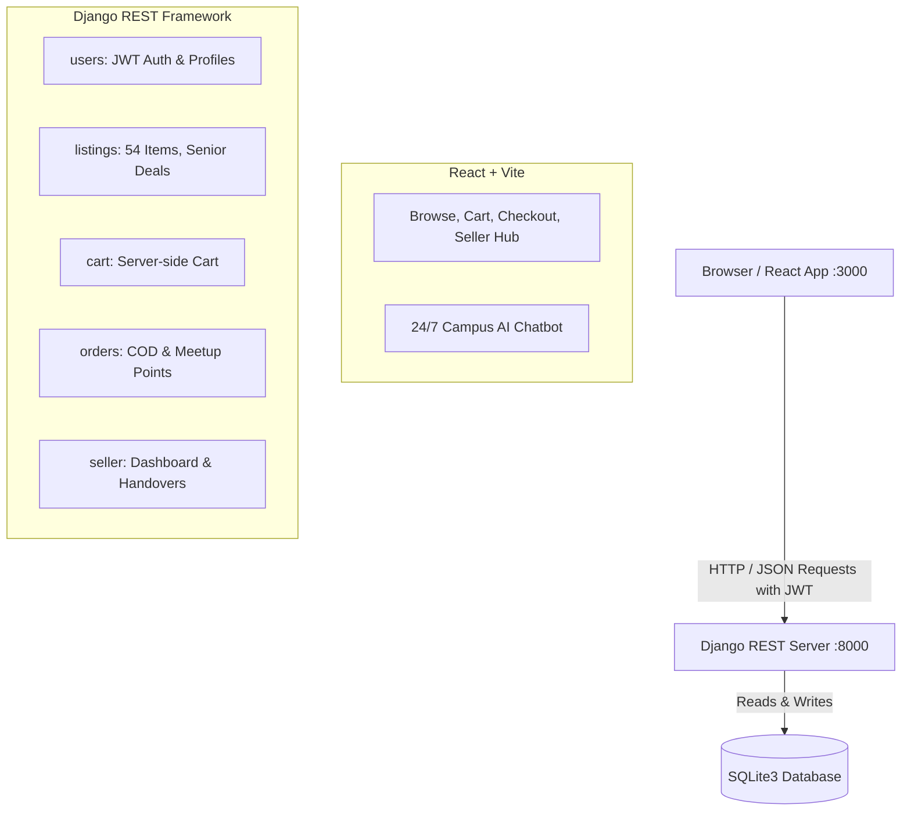

# 🎓 CampusMart — College Campus Marketplace

[](https://github.com/prabhavathi11-code/CampusMart)
[](http://localhost:3000)
[](http://localhost:8000)
[](LICENSE)

> **CampusMart** is an online peer-to-peer marketplace engineered specifically for college campus communities. Students can browse, filter, search, bargain, add items to a persistent cart, choose verified campus meetup points (Library Steps, Main Gate, Canteen), and place cash-on-delivery orders. Graduating seniors can clear out their dorms with **Senior-Only Deals**, and sellers enjoy a full sales management suite with an interactive **7-day sales chart** and handover queue.

---

## 🔗 Live Links & Repository

- **GitHub Repository**: [https://github.com/prabhavathi11-code/CampusMart](https://github.com/prabhavathi11-code/CampusMart)
- **Frontend Local URL**: [http://localhost:3000](http://localhost:3000)
- **Backend API URL**: [http://localhost:8000](http://localhost:8000)
- **Deployment Ready**: Configured with `vercel.json` (Vercel) & `render.yaml` (Render full-stack)

---

## ⚡ Demo Test Credentials

The database is seeded with **54 verified campus listings** and **6 historical orders**. Use the credentials below to test both roles:

| Role | Username | Password | Access Capabilities |
| :--- | :--- | :--- | :--- |
| **Seller** | `Priya` | `secret123` | Owns all 54 listings, accesses Seller Hub, manages orders, updates statuses, views 7-day sales chart |
| **Student** | `Arjun` | `secret123` | Browses listings, unlocks Senior Deals, adds to cart, places COD orders, tracks delivery |
| **Visitor** | *(Not logged in)* | — | Public catalog browsing, search, filter, and sorting. Senior Deals and cart remain locked |

---

## 🏗️ System Architecture

CampusMart operates as two decoupled programs running simultaneously:



---

## 📡 The 21 REST API Endpoints

### 🔐 1. Authentication & Users
- `POST /api/users/register/`: Create campus account (returns `201` with `{"message": "Account created!"}`)
- `POST /api/users/login/`: SimpleJWT login (returns `access` and `refresh` tokens)
- `POST /api/users/login/refresh/`: Refresh expired access token
- `POST /api/users/logout/`: Blacklists refresh token on server (returns `205 Reset Content`)
- `GET /api/users/profile/`: Fetch authenticated user profile and `user_type`

### 📚 2. Listings Catalog
- `GET /api/listings/`: List public listings with pagination (`page_size=5`), category/hostel filters, and sorting
- `GET /api/listings/?is_senior_deal=true`: Senior deals strip (returns `401` if not logged in; returns 6 deals when authenticated)
- `POST /api/listings/`: Post a new listing (authenticated)
- `GET /api/listings/<id>/`: Retrieve one listing (answers `401` for senior deals if unauthenticated)
- `GET /api/listings/<id>/similar/`: Retrieve similar category campus listings

### 🛒 3. Cart Management
- `GET /api/cart/`: Fetch current user's server-stored cart
- `POST /api/cart/add/`: Add listing (`{"listing": id, "quantity": 1}`) — returns `201`
- `PATCH /api/cart/items/<id>/`: Set item quantity (`{"quantity": n}`) — returns `200`
- `DELETE /api/cart/items/<id>/`: Remove item row — returns `204 No Content`
- `DELETE /api/cart/`: Clear whole cart — returns `204 No Content`

### 📦 4. Orders & Checkout
- `POST /api/orders/checkout/`: Place order with `{ payment_method, meetup_point, address }` — returns `201`
- `GET /api/orders/`: List logged-in student's orders
- `GET /api/orders/<id>/`: Details of one order (answers `404` for unauthorized users)
- `POST /api/orders/<id>/cancel/`: Cancel placed order

### 💼 5. Seller Hub & Analytics
- `GET /api/seller/listings/`: List seller's own listings (renames `imageUrl` to `image_url`)
- `POST /api/seller/listings/`: Create seller listing
- `GET/PATCH/DELETE /api/seller/listings/<id>/`: Edit or delete seller listing (answers `403` if not owner)
- `GET /api/seller/orders/`: Orders queue to hand over
- `PATCH /api/seller/orders/<id>/status/`: Advance row status (`placed` ➔ `shipped` ➔ `delivered`)
- `GET /api/seller/dashboard/`: 4 KPI metrics, "Still to Hand Over" queue, 7-day sales chart, top items

### 🤖 6. AI Campus Assistant
- `POST /api/chatbot/`: Intelligent product queries, meetup assistance, and condition guidance

---

## 🚀 How to Run the Project Locally

Open two separate terminals and leave both running.

### 🐍 Terminal 1: Backend (Django REST Framework)

```powershell
# Navigate to backend
cd backend

# Activate virtual environment
.\env\Scripts\activate

# Apply migrations
python manage.py migrate

# Seed accounts, 54 listings, and demo orders
python manage.py seed_listings --with-orders

# Start backend server on Port 8000
python manage.py runserver 8000
```

### ⚡ Terminal 2: Frontend (Vite + React)

```powershell
# Navigate to frontend
cd frontend

# Install packages
npm install

# Start Vite dev server on Port 3000
npm run dev
```

Then visit **`http://localhost:3000`** in your browser.

---

## ✅ Quality Checklist Verified

1. **Both servers run**: List displays 54 listings across 11 pages (page size 5).
2. **Senior Deals Authentication Gate**: Unauthenticated visitors see the login prompt, and the request answers `401`.
3. **JWT Cookies**: Logging in puts `jwt_token` and `refresh_token` in cookies; logging out answers `205` and removes them.
4. **Filters & Search**: Category filtering works, `Sports` correctly shows 0 items, price ordering works, and Enter sends exactly 1 request.
5. **Persistent Cart**: Reloading keeps the cart; different users have separate carts.
6. **Permission Controls**: Arjun attempting to edit Priya's listing answers `403 Forbidden`.
7. **Checkout**: Placing an order sends COD, meetup point, and address; empties the cart; answers `201`; and opens the new order.
8. **Automated Order Advancement**: Marking every item row delivered automatically updates the parent order badge to `delivered`.
9. **Interactive 7-Bar Chart**: Draws 7 distinct bars for the last 7 days, including zero days.
10. **Clean Environment Configuration**: No hardcoded API ports anywhere in code except `.env`.

---

## 👩‍💻 Author & Maintainer

- **Developer**: Chirumala Prabhavathi
- **Project**: CampusMart College Marketplace
